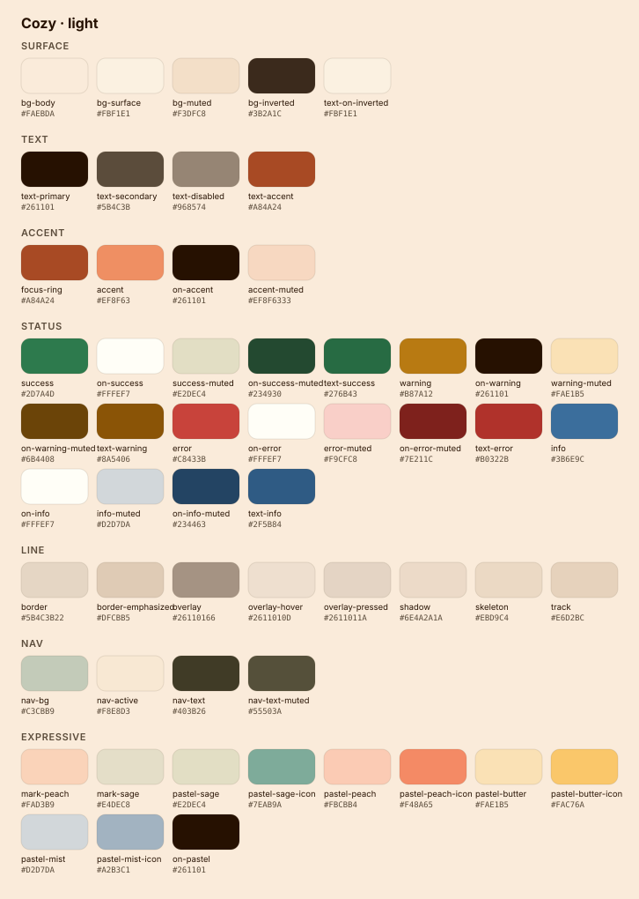

# Cozy

A warm design system for web apps: cream and espresso tones, measured contrast, and calm motion. Light and dark mode come from one set of tokens.

Cozy was extracted from an internal admin app. It contains tokens, CSS effects, small motion helpers, and written rules. It does not contain components, so you can use it with any component library.

<picture>
	<source media="(prefers-color-scheme: dark)" srcset="assets/palette-dark.svg" />
	
</picture>

## Contents

| Path | What it is |
| :--- | :--- |
| [`tokens/cozy.tokens.json`](tokens/cozy.tokens.json) | Source of truth for all tokens. Edit this file only |
| [`tokens/cozy.css`](tokens/cozy.css) | CSS custom properties. Colors use `light-dark()` |
| [`tokens/cozy.ts`](tokens/cozy.ts) | The same tokens as a typed TypeScript object |
| [`css/effects.css`](css/effects.css) | Named effects: highlighter, title reveal, list row stagger, navigation indicator, card lift, theme reveal |
| [`js/cozy-motion.js`](js/cozy-motion.js) | Easing and spring presets, stagger delay, title splitter, circular theme reveal |
| [`adapters/astryx/`](adapters/astryx/) | Optional theme for the [Astryx](https://www.npmjs.com/package/@astryxdesign/core) component library |
| [`preview/index.html`](preview/index.html) | A page that shows every token and effect |
| [`docs/`](docs/) | The rules |

## Quick start

1. Load the font and the two style sheets.

   ```html
   <link rel="stylesheet" href="https://fonts.googleapis.com/css2?family=Plus+Jakarta+Sans:wght@400;500;600;700&display=swap" />
   <link rel="stylesheet" href="cozy/tokens/cozy.css" />
   <link rel="stylesheet" href="cozy/css/effects.css" />
   ```

2. Use the tokens.

   ```css
   body {
   	background: var(--cozy-bg-body);
   	color: var(--cozy-text-primary);
   	font-family: var(--cozy-font-family-sans);
   }

   .button-primary {
   	background: var(--cozy-accent);
   	color: var(--cozy-on-accent);
   	border-radius: var(--cozy-radius-full);
   }
   ```

3. Optional: force a mode. Without this attribute, the page follows the operating system.

   ```html
   <html data-theme="dark">
   ```

To install from Git, run `bun add github:tunglt1810/cozy`.

## Documentation

1. [Principles](docs/principles.md): warm palette, measured contrast, two density levels, optional motion.
2. [Foundations](docs/foundations.md): color, typography, spacing, radius, shadow.
3. [Motion](docs/motion.md): curves, springs, named effects, reduced-motion rules.
4. [Patterns](docs/patterns.md): tabs and their look-alikes, button hierarchy, sticky form toolbar.
5. [Contrast report](docs/contrast.md): every documented color pair, measured.

## Preview

The preview page loads ES modules, so it needs an HTTP server. A `file://` URL does not work.

```bash
bunx serve -l 8000
```

Then open <http://localhost:8000/preview/>.

## Change the tokens

1. Edit `tokens/cozy.tokens.json`.
2. Run `bun run build`. The script writes `tokens/cozy.css`, `tokens/cozy.ts`, `docs/contrast.md`, the palette images and the preview page.
3. Run `bun run check`. It fails when a generated file is out of date or a color pair is below its contrast minimum.

The script runs on [Bun](https://bun.sh). It has no dependencies.

## Browser support

`light-dark()` needs Chrome 123, Edge 123, Firefox 120 or Safari 17.5. The circular theme reveal needs the View Transitions API. Other browsers change the theme without the animation.

## License

[MIT](LICENSE). Plus Jakarta Sans uses the SIL Open Font License 1.1.
